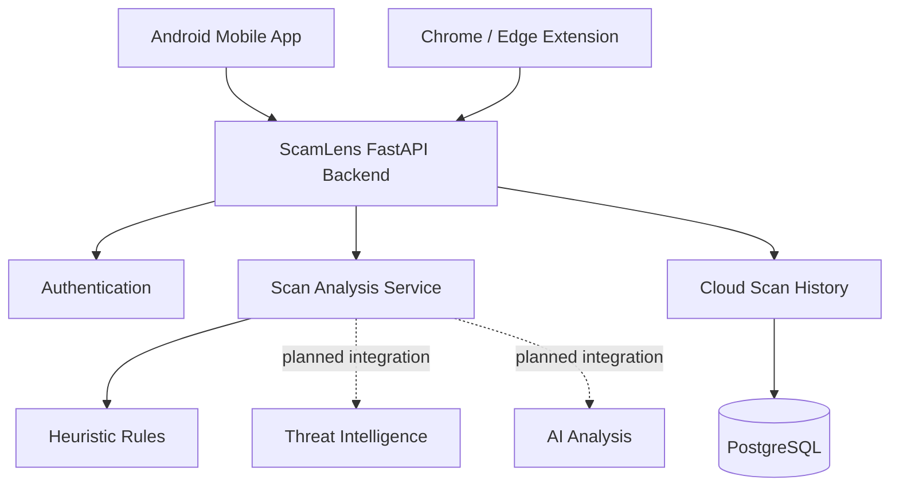

<div align="center">

# 🛡️ ScamLens

### Understand the risk. See the warning signs. Stay safer online.

**ScamLens is a cross-platform scam-awareness project designed to help people inspect suspicious messages and webpages, understand potential warning signs, and make more informed decisions.**

[](#-project-status)
[](#-project-structure)
[](#-project-structure)
[](#-technology-stack)

</div>

---

## ✨ Overview

Scams can arrive through fake payment requests, phishing pages, fraudulent job offers, impersonation messages, and other deceptive content. ScamLens aims to make these situations easier to assess by highlighting suspicious patterns and explaining why content may deserve closer inspection.

The repository is organized into three independent components that work toward one shared product:

- **Mobile** — Android app with a native Quick Scan experience.
- **Extensions** — Chrome-first browser extension, designed to be compatible with Microsoft Edge.
- **Backend** — Python FastAPI service intended to provide shared analysis, authentication, and cloud scan history.

> **Important:** ScamLens is under active development. Current detection uses heuristic rules and is not a guarantee that content is safe or malicious. A low-risk or inconclusive result does not prove legitimacy.

## 🧩 Project structure

```text
ScamLens/
├── Mobile/          # Android app (React Native / Expo + native Android code)
├── extensions/      # Chrome / Edge extension (Manifest V3)
├── backend/         # Python FastAPI API and database layer
└── README.md        # Project overview and getting started
```


## 🚀 Components

<table>
  <tr>
    <td width="33%" valign="top">

### 📱 Mobile

Android-first experience for scanning suspicious content, including a native Quick Scan flow.

**Planned / implemented foundations**
- Native Android Quick Settings tile
- Screen capture consent and OCR flow
- On-device scan analysis prototype
- Result overlay
- Guest and Google sign-in architecture planned

**Folder:** `Mobile/`

    </td>
    <td width="33%" valign="top">

### 🧩 Browser extension

A lightweight browser experience for scanning readable webpage content and reviewing warning signs.

**Features in the prototype**
- One-click webpage text and link scanning
- Right-click page and selected-text actions
- Minimal popup with loading skeleton
- Light and dark theme support
- Full scan report page

**Folder:** `extensions/`

    </td>
    <td width="33%" valign="top">

### ⚙️ Backend

A shared API foundation for mobile and browser clients.

**Starter foundations**
- FastAPI and versioned endpoints
- Google ID-token verification scaffold
- PostgreSQL / SQLAlchemy data layer
- Account-owned scan history endpoints
- Initial heuristic analysis service

**Folder:** `backend/`

    </td>
  </tr>
</table>

## 🏗️ Architecture



The long-term goal is to use one shared analysis API so that supported clients can return consistent scan results. Guest history can remain local, while signed-in users can opt into cloud history and cross-device access.

## 🔍 How scanning is intended to work

1. **Collect content** — extract readable webpage text, links, message text, or OCR text.
2. **Inspect indicators** — look for urgency, sensitive-information requests, suspicious payment language, unusual URLs, and other contextual signals.
3. **Analyze evidence** — combine rule-based checks with additional reputation or AI services as they are integrated.
4. **Return an explanation** — show the risk assessment, observed warning signs, limitations, and recommended next steps.
5. **Store history according to user choice** — local history for guest usage and optional cloud history for authenticated accounts.

ScamLens should distinguish between **risk** and **verification**. Suspicious wording alone cannot prove a message is fake, and the absence of warning signs cannot prove it is safe.

## 🧰 Technology stack

| Component | Technologies |
|---|---|
| Mobile | React Native, Expo, native Android Kotlin |
| Browser extension | JavaScript, HTML, CSS, Chrome Extensions Manifest V3 |
| Backend | Python, FastAPI, Pydantic |
| Database layer | SQLAlchemy, PostgreSQL |
| Migrations | Alembic |
| Authentication | Google identity verification and ScamLens API tokens |
| Local development | Python virtual environment, Docker Compose |

Technology and implementation details may evolve as the project develops.

## 📦 Getting started

Clone the repository:

```bash
git clone <YOUR_GITHUB_REPOSITORY_URL>
cd ScamLens
```

### 1. Mobile

```bash
cd Mobile
```

Follow the component-specific README for dependency installation, Expo setup, Android native requirements, and device/emulator instructions.

### 2. Browser extension

```bash
cd extensions
```

For local development in Chrome:

1. Open `chrome://extensions`.
2. Enable **Developer mode**.
3. Select **Load unpacked**.
4. Choose the `extensions/` directory that contains `manifest.json`.
5. Pin ScamLens to the browser toolbar.

For Microsoft Edge, open `edge://extensions` and follow the equivalent steps.

A locally loaded extension is for development. Public one-click installation requires publishing through the relevant browser extension store.

### 3. Backend

```bash
cd backend
```

Use the backend's own README and `.env.example` for database configuration and setup. A typical Python workflow is:

```bash
python -m venv .venv
```

Activate the environment:

```powershell
# Windows PowerShell
.\.venv\Scripts\Activate.ps1
```

```bash
# macOS / Linux
source .venv/bin/activate
```

Then install dependencies and follow the backend's migration and launch instructions:

```bash
pip install -r requirements.txt
alembic upgrade head
uvicorn app.main:app --reload
```

When running locally, the API documentation is normally available at `http://127.0.0.1:8000/docs`.

**Setup note:** The commands above assume the backend README and entry point use these paths. Follow the instructions in `backend/README.md` if they differ.

## 🔐 Privacy and security principles

ScamLens is being designed around these principles:

- **Guest-first access:** scanning should not require account creation.
- **Local-first guest history:** guest scan history should stay on the device unless the user explicitly chooses to export or import it.
- **Consent-based cloud history:** signed-in cloud history should be linked to the authenticated account.
- **Minimal retention:** avoid retaining full scanned messages or webpage contents unless needed and clearly opted into.
- **Secure authentication:** verify identity tokens on the backend; never trust a client-supplied user ID.
- **No embedded secrets:** never commit API keys, database passwords, OAuth client secrets, or production tokens.
- **Explainable results:** show the signals behind a result and be clear about uncertainty.

These are project goals and design principles; review the individual component implementations before assuming every item is fully enforced.

## 🗺️ Roadmap

- [x] Establish separate mobile, browser-extension, and backend components
- [x] Build an Android native Quick Scan prototype
- [x] Build the initial Chrome / Edge extension prototype
- [x] Create the initial FastAPI backend structure
- [ ] Run integration tests across the three components
- [ ] Connect the extension to the shared analysis API
- [ ] Connect Android scans to the shared analysis API
- [ ] Complete Google sign-in and token lifecycle for supported clients
- [ ] Implement and test guest-history import with explicit consent
- [ ] Integrate a URL reputation provider with privacy safeguards
- [ ] Evaluate detection against labelled legitimate and malicious examples
- [ ] Add production logging, rate limiting, monitoring, and deployment configuration
- [ ] Prepare Chrome Web Store and Microsoft Edge Add-ons releases

## 🧪 Development guidelines

- Keep each component's implementation and setup instructions in its own directory.
- Keep shared API contracts consistent across mobile and browser clients.
- Add tests for new analysis rules and API behavior.
- Never treat heuristic scores as verified truth.
- Avoid logging sensitive message or webpage contents.
- Update this README when the architecture or setup steps change.

## 🤝 Contributing

Contributions, bug reports, and thoughtful feedback are welcome.

1. Open an issue describing the bug, feature, or improvement.
2. Keep changes focused on one component where possible.
3. Add or update tests and documentation.
4. Never include secrets, personal data, or real users' private scam messages in commits or test fixtures.

Contribution guidelines, licensing, and security reporting instructions can be added as the repository matures.

## ⚠️ Disclaimer

ScamLens is an informational tool intended to help users identify possible warning signs. It is not a bank, law-enforcement service, fact-checking authority, or guarantee of cybersecurity. Detection may produce false positives and false negatives. Independently verify sensitive requests using trusted official channels, and never share passwords, one-time passwords, or recovery codes in response to unsolicited messages.

---

<div align="center">

**Built to make suspicious content easier to question — not to replace your judgment.**

</div>
