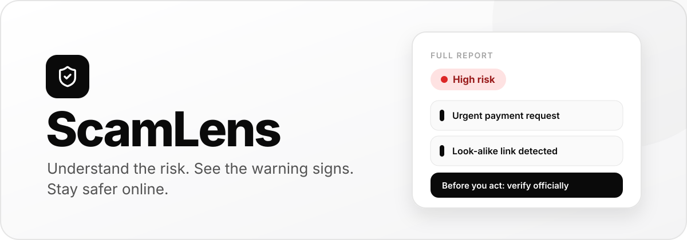
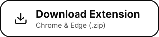
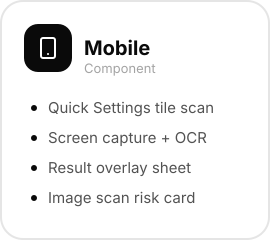
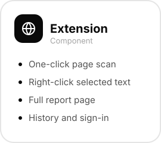
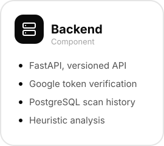
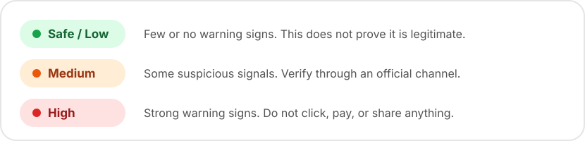
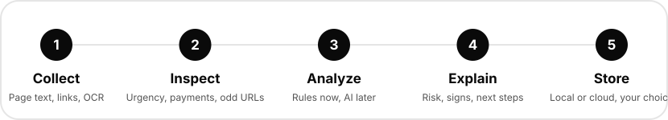
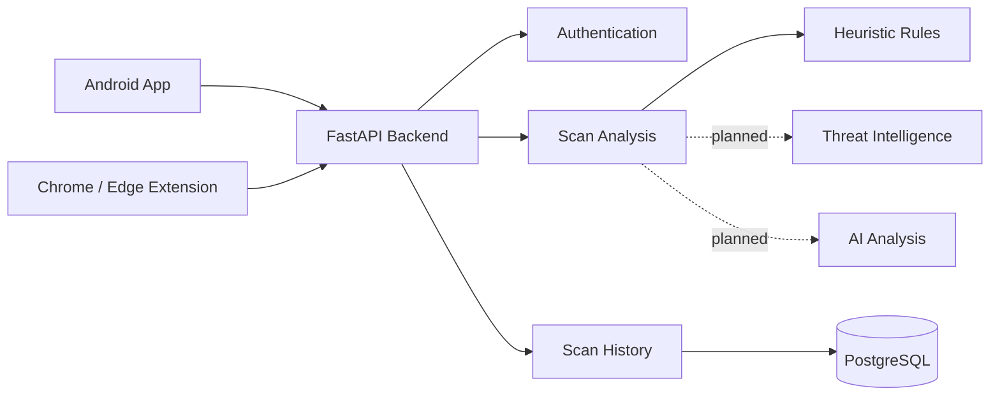

<!--
  REPLACE THESE 2 LINKS (search this file for them):
    YOUR_APK_LINK            -> direct link to your .apk (e.g. GitHub Releases asset)
    YOUR_EXTENSION_ZIP_LINK  -> direct link to your extension .zip
  Also replace YOUR_USERNAME with your GitHub username.
  Screenshots: add images to assets/screens/ (names listed in the Screenshots section).
-->
 
<div align="center">

<br/>
<br/>
**Inspect suspicious messages and webpages, understand the warning signs, and decide with confidence.**
 
<br/>
<a href="#download"><b>Download</b></a> &nbsp;·&nbsp;
<a href="#features"><b>Features</b></a> &nbsp;·&nbsp;
<a href="#how-it-works"><b>How it works</b></a> &nbsp;·&nbsp;
<a href="#getting-started"><b>Getting started</b></a> &nbsp;·&nbsp;
<a href="#roadmap"><b>Roadmap</b></a>
 
</div>
<br/>
> [!IMPORTANT]
> ScamLens is in active development. Detection uses heuristic rules and is **not** a guarantee that content is safe or malicious. A low-risk or inconclusive result does not prove legitimacy.
 
<br/>
## Download
 
<div align="center">
<a href="YOUR_APK_LINK"></a>
&nbsp;&nbsp;
<a href="YOUR_EXTENSION_ZIP_LINK"></a>
 
<sub>Android 10+ recommended &nbsp;·&nbsp; Chrome / Edge 110+ (Manifest V3) &nbsp;·&nbsp; Guest scanning needs no account</sub>
 
</div>
<br/>
### Install the Android app
 
1. Download the **APK** using the button above.
2. Open the file on your phone. If asked, allow **Install unknown apps** for your browser or file manager.
3. Tap **Install**, then open ScamLens.
4. Add the **Quick Scan** tile from your Quick Settings panel for one-tap scanning.
### Install the browser extension
 
1. Download the extension **ZIP** using the button above and **extract** it to a folder.
2. Open `chrome://extensions` in Chrome, or `edge://extensions` in Edge.
3. Turn on **Developer mode**.
4. Click **Load unpacked** and select the extracted folder that contains `manifest.json`.
5. Pin **ScamLens** to your toolbar.
> [!TIP]
> Keep the extracted folder in a permanent location. Moving or deleting it will disable the extension.
 
<br/>
## Overview
 
Scams arrive as fake payment requests, phishing pages, fraudulent job offers, and impersonation messages. ScamLens makes them easier to assess by highlighting suspicious patterns and explaining **why** something deserves a closer look.
 
One product, three independent components:
 
<div align="center">

&nbsp;

&nbsp;

</div>
<br/>
## Features
 
| | |
|---|---|
| **Quick Scan** | Android Quick Settings tile captures the screen, reads text with on-device OCR, and shows the result in a bottom sheet. |
| **Page scanning** | One click scans readable page text and links. Right-click any page or selected text to scan it. |
| **Full report** | A clean report with a risk badge, evidence cards, and a "Before you act" panel. |
| **Fast feedback** | Skeleton loading in the popup and light or dark theme support. |
| **Scan history** | Local for guests. Cloud history and cross-device access when signed in. |
| **Shared analysis API** | A FastAPI backend so every client can return consistent results. |
 
<br/>
## Understanding results
 
<div align="center">

</div>
<br/>
ScamLens separates **risk** from **verification**: suspicious wording alone cannot prove a message is fake, and the absence of warning signs cannot prove it is safe.
 
<br/>
## How it works
 
<div align="center">

</div>
<br/>
## Screenshots
 
<div align="center">


</div>
<br/>
## Architecture
 

 
```text
ScamLens/
├── Mobile/        Android app (React Native / Expo + native Kotlin)
├── extensions/    Chrome / Edge extension (Manifest V3)
├── backend/       Python FastAPI API and database layer
└── assets/        Banner, buttons, and screenshots
```
 
<br/>
## Tech stack
 
<div align="center">


 
</div>
<br/>
## Getting started
 
```bash
git clone https://github.com/YOUR_USERNAME/ScamLens.git
cd ScamLens
```
 
<details>
<summary><b>Mobile (Android)</b></summary>
<br/>
```bash
cd Mobile
```
 
Follow the component README for dependency installation, Expo setup, Android native requirements, and device or emulator instructions.
 
</details>
<details>
<summary><b>Browser extension (development)</b></summary>
<br/>
Load the `extensions/` folder with **Load unpacked** in `chrome://extensions` or `edge://extensions` (Developer mode on). The folder must contain `manifest.json`.
 
</details>
<details>
<summary><b>Backend</b></summary>
<br/>
```bash
cd backend
python -m venv .venv
```
 
```powershell
# Windows PowerShell
.\.venv\Scripts\Activate.ps1
```
 
```bash
# macOS / Linux
source .venv/bin/activate
```
 
```bash
pip install -r requirements.txt
alembic upgrade head
uvicorn app.main:app --reload
```
 
API docs are normally available at `http://127.0.0.1:8000/docs`. Copy `.env.example` to `.env` and fill in your own values. Follow `backend/README.md` if your paths differ.
 
</details>
<br/>
## Privacy and security
 
- **Guest-first:** scanning does not require an account.
- **Local-first history:** guest history stays on the device unless you export or import it.
- **Consent-based cloud history:** linked to the authenticated account only.
- **Minimal retention:** full scanned content is not kept unless needed and opted into.
- **Secure auth:** tokens are verified on the backend; a client-supplied user ID is never trusted.
- **No embedded secrets:** never commit keys, passwords, OAuth secrets, or production tokens.
- **Explainable results:** signals are shown and uncertainty is stated plainly.
These are project goals. Review each component before assuming every item is fully enforced.
 
<br/>
## Roadmap
 
- [x] Separate mobile, extension, and backend components
- [x] Android Quick Scan prototype
- [x] Chrome / Edge extension with full report page
- [x] Initial FastAPI backend
- [ ] Integration tests across all components
- [ ] Connect extension and Android to the shared analysis API
- [ ] Complete Google sign-in and token lifecycle
- [ ] Guest-history import with explicit consent
- [ ] URL reputation provider with privacy safeguards
- [ ] Evaluate detection on labelled legitimate and malicious examples
- [ ] Production logging, rate limiting, monitoring, and deployment
- [ ] Public store releases for the app and extension
<br/>
## Contributing
 
Contributions, bug reports, and feedback are welcome.
 
1. Open an issue describing the bug, feature, or improvement.
2. Keep changes focused on one component where possible.
3. Add or update tests and documentation.
4. Never include secrets, personal data, or real users' private scam messages in commits or fixtures.
Never treat heuristic scores as verified truth, and avoid logging sensitive message or webpage contents.
 
<br/>
## Disclaimer
 
ScamLens is an informational tool that helps you spot possible warning signs. It is not a bank, law-enforcement service, fact-checking authority, or guarantee of cybersecurity. Detection may produce false positives and false negatives. Verify sensitive requests through trusted official channels, and never share passwords, one-time passwords, or recovery codes in response to unsolicited messages.
 
<br/>
<div align="center">

<sub>Built to make suspicious content easier to question, not to replace your judgment.</sub>
 
</div>
 